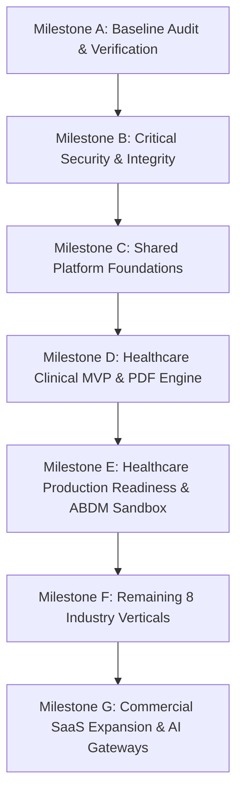

# AppointoCare — Master Incremental Implementation Plan

**Objective:** Evolve the operational modular-monolith SaaS into an enterprise-grade multi-industry platform.  
**Priority Focus:** Healthcare First, Shared Platform Core, Production Security & Compliance.  

---

## Roadmap Overview

---

## Milestone Detail & Acceptance Criteria

### Milestone A: Repository Discovery & Baseline (COMPLETED)
- **Status:** ✅ Complete.
- **Verification:** 191/191 unit & audit tests passed; 216/216 E2E industry tests passed.
- **Deliverables:** Architectural inventory, verified test runner, persistent docs suite in `docs/`.

### Milestone B: Security & Integrity (CURRENT ACTIVE MILESTONE)
- **Objective:** Eliminate P0 security vulnerabilities without breaking existing functionality.
- **Scope:**
  1. Patch `_resolve_tenant_id()` in `appointocare-backend/app/service_guards.py` to eliminate fallback to tenant 1.
  2. Implement strict production secret validation in `appointocare-backend/app/__init__.py`.
  3. Validate tenant isolation on sensitive routes (appointments, records, customers).
  4. Mask sensitive information in application logs.
- **Tests:** Add automated security regression tests verifying failure on missing tenant IDs and default secrets.

### Milestone C: Shared Platform Foundations
- **Objective:** Strengthen multi-tenant enterprise core.
- **Scope:**
  1. Centralized feature entitlement and subscription enforcement service.
  2. Document abstraction layer (file upload, validation, metadata, time-limited signed URLs).
  3. Reliable Celery background job retry policies and error handling.
  4. Expanded audit logging for sensitive actions.

### Milestone D: Healthcare Clinical MVP & Branded PDF Engine
- **Objective:** Establish comprehensive, compliant clinical workflow for Healthcare pilot tenant (`ORG1`).
- **Scope:**
  1. Lightweight server-side PDF generation engine (`appointocare-backend/app/services/pdf_service.py` using ReportLab).
  2. Branded Digital E-Prescription output with clinic letterhead, doctor registration, and verification QR/link.
  3. Fullscreen waiting-room public token board display view (`/queue/display`).
  4. Concurrency-safe appointment booking with database row-level locking.
  5. Configurable vitals alert thresholds and clinical examination encounter notes.

### Milestone E: Healthcare Production Readiness & ABDM Strategy
- **Objective:** Prepare Healthcare vertical for full Indian compliance.
- **Scope:**
  1. HIPAA / DPDP Act 2023 compliance audit for patient health data.
  2. ABDM Milestone 1 (M1) & M2 sandbox integration strategy and data format mapping.
  3. Automated appointment reminders via WhatsApp Cloud API scheduled through Celery Beat.
  4. End-to-end clinical workflow pilot validation.

### Milestone F: Remaining 8 Industry Verticals
- **Wave 1:** Salon & Wellness (`ORG2`), Retail (`ORG5`).
- **Wave 2:** Finance (`ORG3`), Insurance (`ORG4`), Consultancy (`ORG7`).
- **Wave 3:** Education (`ORG6`), Real Estate (`ORG8`), Professional Services (`ORG9`).

### Milestone G: Commercial SaaS Expansion
- **Objective:** Automated self-service subscription upgrades, usage quotas, and AI-assisted clinical summaries.
